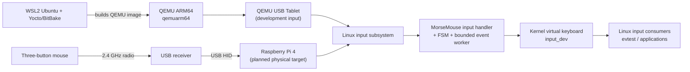

# MorseMouse

**A Yocto-based Embedded Linux project that turns a three-button mouse into a Morse-code keyboard.**

[](https://www.yoctoproject.org/)
[](https://www.qemu.org/)
[](https://github.com/Rishabh-1803/aeld-final-project/tree/coursera-sprint-1)
[](https://github.com/Rishabh-1803/aeld-final-project/issues)

**Student:** Rishabh Shah · **Course:** Advanced Embedded Linux Development · **Project type:** Individual

| Documentation | Link |
|---|---|
| Project Overview (course wiki) | [Open Project Overview](https://github.com/Rishabh-1803/aeld-final-project/wiki/Project-Overview) |
| Project Schedule (course wiki) | [Open Project Schedule](https://github.com/Rishabh-1803/aeld-final-project/wiki/Project-Schedule) |
| GitHub Issues | [Open issue tracker](https://github.com/Rishabh-1803/aeld-final-project/issues) |
| Architecture and project status | [`docs/architecture.md`](docs/architecture.md) · [`docs/project-status.md`](docs/project-status.md) |
| Build instructions | [`docs/build-qemuarm64.md`](docs/build-qemuarm64.md) |
| Source pins | [`manifest/source-pins.md`](manifest/source-pins.md) |

---

## 1. Project Overview

MorseMouse uses a three-button mouse as a discrete Morse input device:

| Mouse input | Morse action |
|---|---|
| Left button press | DOT (`.`) |
| Right button press | DASH (`-`) |
| Middle button press | COMMIT current character |
| Button release | Rearm; does not append a symbol |
| Left + right held together | Cancel current sequence and lock out until both are released |
| Scroll wheel | Disabled in v1 |

The authoritative Morse map covers all **95 printable ASCII characters** (decimal 32–126), with a declared US-QWERTY output mapping.

## 2. Architecture at a Glance



QEMU is the current development and validation target. Raspberry Pi 4 and the physical receiver are the planned final hardware target and remain gated by QEMU integration acceptance.

## 3. Target Build System and Hardware

- **Build system:** Yocto Project / Poky, Scarthgap 5.0.21.
- **QEMU development target:** `MACHINE = "qemuarm64"`.
- **Planned physical target:** Raspberry Pi 4 64-bit, `MACHINE = "raspberrypi4-64"`, supported through the [`meta-raspberrypi` BSP layer](https://github.com/agherzan/meta-raspberrypi).
- **Physical input peripheral:** Zebronics PULSE mouse with 2.4 GHz USB receiver.
- **Current status:** QEMU image/build and input-handler/FSM validation have evidence. Raspberry Pi physical build/boot and receiver validation are deferred until the QEMU gate passes.

## 4. Current Progress

| Workstream | Status |
|---|---|
| Yocto QEMU baseline and development image | Complete |
| Approved v1 grammar and 95-character map | Complete |
| Userspace reference decoder and `uinput` proof of concept | Complete |
| QEMU kernel input handler and reversible grab lifecycle | Complete |
| Kernel Morse FSM, bounded queue and teardown stress testing | Complete |
| Kernel virtual keyboard (`input_dev`) | Implementation underway; build and QEMU event verification pending |
| `/dev/morse_hid` UAPI | Planned |
| `morsed` daemon and guarded power policy | Planned |
| Read-only telemetry/HUD | Planned |
| Final QEMU integration and physical Pi/receiver validation | Planned |

Sprint 1 snapshot: [`coursera-sprint-1`](https://github.com/Rishabh-1803/aeld-final-project/tree/coursera-sprint-1). The tag is a frozen submission boundary, not a claim that later Sprint 2 work is complete.

## 5. Repository Layout

```text
meta-morse-mouse/   Project Yocto layer, recipes and image configuration
driver/             Kernel input handler and generated kernel Morse map
tools/              Reference decoder, shared FSM, keymap and host tests
config/             Authoritative Morse mapping
tests/              Shared FSM vectors and validators
docs/               Architecture, grammar, build and project status
manifest/           Pinned upstream layer/source revisions
evidence/            Build, boot and QEMU test reports
```

## 6. Build and Test

The reproducible QEMU build instructions are in [`docs/build-qemuarm64.md`](docs/build-qemuarm64.md).

Typical host regression command:

```bash
make -C tools clean all test
```

Yocto image build (from the repository root, after sourcing the build environment):

```bash
bitbake core-image-morse-dev
```

## 7. Scope and Validation Boundaries

- The current Morse grammar is explicit-commit and button-identity based; it is not a timed Morse-gap decoder.
- QEMU validation is not evidence of physical receiver compatibility.
- The final Raspberry Pi 4 and Zebronics hardware stage starts only after the QEMU integration gate.
- Visible text insertion into a graphical application, the daemon, HUD and power policy are not claimed as complete until implemented and tested.

## 8. Course Submission Links

- [Project Overview Wiki Page](https://github.com/Rishabh-1803/aeld-final-project/wiki/Project-Overview)
- [Project Schedule Wiki Page](https://github.com/Rishabh-1803/aeld-final-project/wiki/Project-Schedule)
- [Sprint 1 submission tag](https://github.com/Rishabh-1803/aeld-final-project/tree/coursera-sprint-1)
- [Sprint 2 — Issue #7: virtual keyboard](https://github.com/Rishabh-1803/aeld-final-project/issues/7)
- [Sprint 2 — Issue #8: character-device UAPI](https://github.com/Rishabh-1803/aeld-final-project/issues/8)
- [All project issues](https://github.com/Rishabh-1803/aeld-final-project/issues)