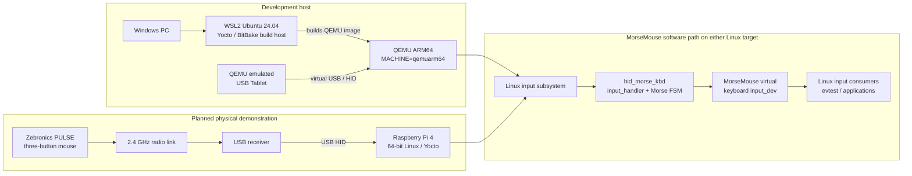

# MorseMouse — Project Overview

> **Advanced Embedded Linux Development — Individual Final Project**  
> **Student:** Rishabh Shah  
> **Target build system:** Yocto Project (Poky / Scarthgap)  
> **Development target:** QEMU ARM64 (`qemuarm64`)  
> **Planned physical target:** Raspberry Pi 4, 64-bit (`raspberrypi4-64`)

[Project Schedule](https://github.com/Rishabh-1803/aeld-final-project/wiki/Project-Schedule) ·
[Source repository](https://github.com/Rishabh-1803/aeld-final-project) ·
[Issue tracker](https://github.com/Rishabh-1803/aeld-final-project/issues)

---

## Overview

MorseMouse is an embedded Linux input system that converts a standard three-button mouse into a Morse-code text-entry device. The left and right mouse buttons represent DOT and DASH, and the middle button commits the entered Morse sequence. The decoded character is translated into a Linux US-QWERTY key event.

The project is developed as a Yocto-based embedded Linux image. QEMU ARM64 is used as the repeatable development and integration platform. After QEMU-side kernel and userspace acceptance is complete, the same project layer will be built for a physical Raspberry Pi 4 and tested with a Zebronics PULSE mouse and its 2.4 GHz USB receiver.

The design is event-based rather than time-gap based. Button identity determines DOT or DASH; release rearms the button; the middle button explicitly commits a character. Simultaneous left/right presses cancel the current sequence and lock input until both buttons are released. Scroll-wheel gestures and automatic character timeouts are excluded from v1.

## Project Goals and Motivation

The goal is to demonstrate an end-to-end embedded Linux input path that combines Yocto image generation, Linux input handling, kernel event processing and keyboard event synthesis.

1. Convert a three-button mouse into a discrete Morse input device.
2. Support all 95 printable ASCII characters (decimal 32–126) using the project's documented Morse map and US-QWERTY keymap.
3. Implement deterministic DOT, DASH, COMMIT, cancellation and lockout behavior.
4. Use a targeted Linux input handler and a kernel-registered virtual keyboard.
5. Expose driver status through a documented interface, then integrate a userspace daemon and read-only HUD.
6. Validate the software in QEMU before the final Raspberry Pi and physical mouse stage.

### System and hardware connectivity diagram

**Diagram notes:** The QEMU USB Tablet is an emulated development input device; it is not the physical mouse. On the final hardware target, the Zebronics mouse communicates wirelessly with its USB receiver, and the receiver connects to the Raspberry Pi 4 over USB. The virtual keyboard is a Linux input device, not a separate physical keyboard. Event-level validation with `evtest` is the acceptance criterion; visible text insertion into a graphical application is a later demonstration item.

## Target Build System

**Yocto Project (Poky), Scarthgap 5.0.21.** Buildroot is not the selected build system.

- Poky provides the reference distribution, OpenEmbedded-Core metadata and BitBake build environment.
- The project layer is `meta-morse-mouse`.
- The QEMU development image is `core-image-morse-dev`.
- The current development machine is `MACHINE = "qemuarm64"`.
- The planned physical build machine is `MACHINE = "raspberrypi4-64"` using the Raspberry Pi BSP layer.

Pinned source revisions are recorded in [`manifest/source-pins.md`](https://github.com/Rishabh-1803/aeld-final-project/blob/main/manifest/source-pins.md). The current verified QEMU baseline uses Poky Scarthgap 5.0.21. Raspberry Pi image generation and physical boot are deliberately deferred until the QEMU integration gate is complete.

## Hardware Platform

### Development platform — QEMU ARM64

- **Host:** Windows PC running WSL2 Ubuntu 24.04.
- **Emulated target:** QEMU ARM64, Yocto machine `qemuarm64`.
- **Input peripheral:** QEMU's emulated USB Tablet, exposing left, right and middle mouse-button events.
- **Purpose:** Kernel module development, event injection, FSM testing, queue stress tests, virtual keyboard event inspection and reproducible integration validation.

`qemuarm64` is a virtual ARM64 machine target, not a physical board. It is used to validate the Linux software path independently of the final receiver hardware.

### Planned physical platform — Raspberry Pi 4

- **Board:** Raspberry Pi 4, 64-bit target (`raspberrypi4-64`).
- **Processor family:** Broadcom BCM2711 / 64-bit ARM Cortex-A72.
- **Input peripheral:** Zebronics PULSE three-button mouse and its 2.4 GHz USB receiver.
- **Connection:** Mouse-to-receiver wireless link; receiver-to-Pi USB connection.
- **Yocto support:** The `meta-raspberrypi` BSP layer provides Raspberry Pi machine configurations, including `raspberrypi4-64`. The project kernel recipe is intended to support both `qemuarm64` and `raspberrypi4-64`.

The course's [Supported Hardware Platforms](https://github.com/cu-ecen-aeld/aesd-assignments/wiki/Supported-Hardware-Platforms) page directs Yocto projects to the [course Yocto assignments base wiki](https://github.com/cu-ecen-aeld/yocto-assignments-base/wiki). That course wiki includes a [worked Raspberry Pi Yocto image guide](https://github.com/cu-ecen-aeld/yocto-assignments-base/wiki/Build-basic-YOCTO-image-for-RaspberryPi): it describes adding `meta-raspberrypi` and `meta-openembedded` alongside Poky, selecting the appropriate machine, building an image, flashing an SD card and booting the board. The project-specific BSP is the upstream [meta-raspberrypi layer](https://github.com/agherzan/meta-raspberrypi), which provides the `raspberrypi4-64` machine configuration used in the planned physical build.

**Board availability:** A Raspberry Pi 4 is required for the final physical demonstration. Board sourcing/availability will be confirmed before Phase B. No physical board is claimed as built, booted or tested at this stage.

### Hardware status boundary

QEMU ARM64 image builds, QEMU input-event tests and kernel-driver tests are the current development evidence. Raspberry Pi 4 image build, physical boot, receiver VID/PID inspection and real mouse-event validation remain pending until the QEMU integration gate is passed. QEMU results are not presented as physical-hardware results.

## Open Source Projects Used

The project uses or plans to integrate the following upstream open-source projects. Project-specific code is maintained in the MorseMouse repository; upstream dependencies are linked rather than presented as original work.

| Project | Purpose in MorseMouse | Source |
|---|---|---|
| Yocto Project / Poky | Embedded Linux build environment, image metadata and reference distribution | https://github.com/yoctoproject/poky |
| BitBake | Recipe/task execution engine used by Poky | https://github.com/openembedded/bitbake |
| OpenEmbedded-Core | Core recipes, classes and image build metadata | https://github.com/openembedded/openembedded-core |
| meta-openembedded | Additional OpenEmbedded recipes, including utilities used in the development image | https://github.com/openembedded/meta-openembedded |
| meta-raspberrypi | Board support for the planned Raspberry Pi 4 target | https://github.com/agherzan/meta-raspberrypi |
| Linux kernel | Input subsystem, input handlers, input devices, workqueues and kernel interfaces | https://www.kernel.org/ |
| QEMU | Emulated ARM64 development and integration platform | https://www.qemu.org/ |
| evtest | Inspect Linux input-device capabilities and event streams during validation | https://gitlab.freedesktop.org/libevdev/evtest |

The project does not depend on a separate proprietary framework for the Morse decoder. The Morse map, FSM, kernel driver, reference decoder and project-specific Yocto recipes are maintained in this repository.

## Previously Discussed Content

The project builds on topics introduced in the Advanced Embedded Linux Development course and earlier assignments:

- Yocto/Poky setup, BitBake execution, layers, recipes, machine configuration and custom image generation.
- C programming, compilation, linking and cross-compilation concepts.
- Linux userspace interaction with device nodes and file descriptors.
- Linux kernel module structure, initialization, cleanup and build integration.
- Linux input/evdev concepts and the use of tools such as `evtest` to inspect event devices.
- Kernel synchronization and deferred work concepts used when processing device events.

These concepts are being combined into one reproducible embedded Linux project. Course concepts and starter material are acknowledged; no other student's final-project source code is claimed as original MorseMouse implementation.

## New Content

The project extends course material and includes additional Linux driver and system-integration topics.

### Course topics applied in a new context

- A custom Linux `input_handler` that selects a mouse by its event capabilities and identity rather than by a hard-coded `/dev/input/eventN` path.
- A bounded event queue and deferred worker for processing input events outside the non-sleeping input callback.
- A shared Morse FSM used by userspace reference tests and kernel-side processing.
- Kernel-side virtual keyboard event generation through a registered `input_dev`, including modifier ordering and key-release cleanup.

### Additional topics requiring project-specific study and implementation

- A versioned character-device UAPI with `read()`, `poll()` and a constrained `ioctl()` interface.
- A userspace `morsed` daemon, service lifecycle management and a read-only telemetry/HUD client.
- Fail-safe design for queue overflow, disconnect/reconnect, module unload, stale state and unavailable services.
- A guarded, dry-run-by-default power-control policy with local physical confirmation; remote telemetry must not be able to trigger power actions.
- Porting and validating the project layer on the Raspberry Pi 4 BSP, including real USB receiver identification and HID capability inspection.

The kernel input handler and bounded FSM have QEMU evidence. Kernel virtual keyboard implementation, UAPI, daemon, HUD and physical-hardware acceptance must be marked complete only after their respective builds and tests pass.

## Shared Material

This is an individual project. No project code from another student's final project or from a previous semester is intended to be reused as MorseMouse implementation.

The project uses upstream Yocto, OpenEmbedded, Linux kernel, QEMU and BSP sources listed in **Open Source Projects Used**. Their licenses and pinned source revisions remain those of the upstream projects. Course-provided concepts and build-system conventions are reused as learning material, not represented as newly authored upstream software.

## Source Code Organization

### Project implementation repository

**MorseMouse source, Yocto layer, tests, configuration and documentation:**  
https://github.com/Rishabh-1803/aeld-final-project

The same repository contains the project-specific application and kernel implementation as well as the `meta-morse-mouse` Yocto layer. This is the project source repository; the upstream Yocto/Poky build-system source is maintained separately at [yoctoproject/poky](https://github.com/yoctoproject/poky). A separate application-only repository is not currently planned.

| Path | Contents |
|---|---|
| `driver/` | Kernel input handler and generated kernel Morse map |
| `tools/` | C reference decoder, shared FSM, US-QWERTY keymap and host tests |
| `config/` | Authoritative Morse character-to-sequence mapping |
| `meta-morse-mouse/` | Project Yocto layer, recipes and image configuration |
| `tests/` | Shared FSM vectors and validation scripts |
| `docs/` | Architecture, build, grammar and project-status documentation |
| `evidence/` | Build, boot and QEMU validation reports |
| `manifest/` | Pinned external Yocto layer/source revisions |

### Build-system and BSP repositories

| Repository | Role |
|---|---|
| https://github.com/yoctoproject/poky | Yocto/Poky base build-system source |
| https://github.com/openembedded/bitbake | BitBake build engine |
| https://github.com/openembedded/openembedded-core | Core OpenEmbedded metadata |
| https://github.com/openembedded/meta-openembedded | Additional recipe layer |
| https://github.com/agherzan/meta-raspberrypi | Planned Raspberry Pi 4 board support |

The exact revisions used for the QEMU build are recorded in `manifest/source-pins.md`.

## Team Members

This is an **individual project**.

| Member | Role |
|---|---|
| Rishabh Shah | Project design, Yocto integration, kernel driver and FSM implementation, userspace development, QEMU validation, planned hardware validation and documentation |

## Schedule Page

The shared project schedule, sprint milestones, assigned student issues, blockers and issue-level Definitions of Done are maintained here:

**[MorseMouse — Project Schedule](https://github.com/Rishabh-1803/aeld-final-project/wiki/Project-Schedule)**

The schedule page is the source of truth for Sprint 1, Sprint 2 and Sprint 3 tracking.